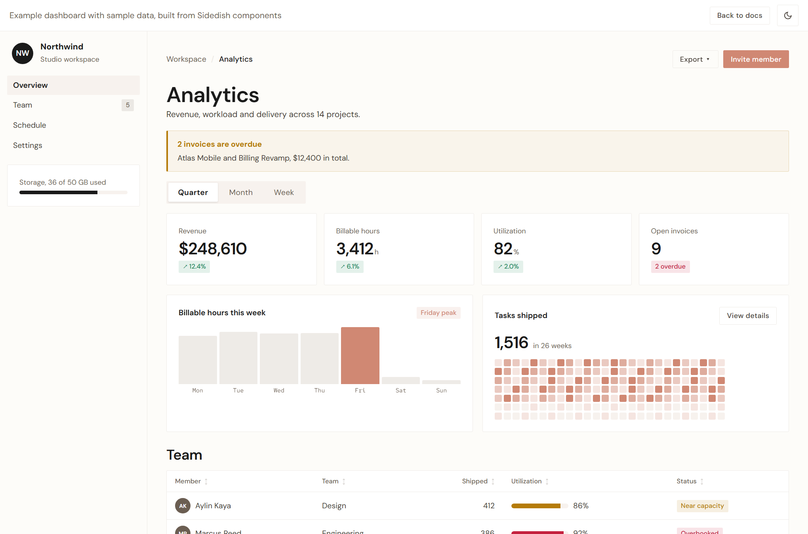

<div align="center">


# Sidedish

**Your app is the main course. This is the UI on the side.**

A small component kit for **Next.js** and **Tailwind CSS v4**, served in terracotta, warm off-white and near-black.

[](https://www.npmjs.com/package/sidedish)


[](LICENSE)

```bash
npx sidedish init
```

<picture>
  <source media="(prefers-color-scheme: dark)" srcset=".github/assets/dashboard-dark.png">
  
</picture>

<sub>The example dashboard from the docs site. Sidedish components, plain Tailwind for layout.</sub>

</div>

## Why a side dish?

- **Light.** All the CSS and JavaScript come to under 10 KB gzipped.
- **Plain HTML first.** Write `<button>`, `<dialog>` or `<details>` and it's already styled. Most of it works in Server Components.
- **Goes with Tailwind.** Styles sit in Tailwind's layers, so your utilities always win.
- **No wrapper maze.** The interactive parts are six web components, plus a few small React helpers.

## Serve it

Run this in the root of a Next.js App Router project:

```bash
pnpm dlx sidedish init   # or: npx sidedish init
```

It installs the packages, adds a PostCSS config if you have none, and wires up `globals.css` and your root layout. No prompts. Use `--no-install` or `--no-fonts` to skip those steps.

<details>
<summary><b>Prefer to cook it yourself?</b></summary>

<br>

```bash
pnpm add sidedish tailwindcss @tailwindcss/postcss postcss
```

```js
// postcss.config.mjs
export default { plugins: { "@tailwindcss/postcss": {} } };
```

```css
/* app/globals.css */
@import "sidedish/fonts.css";   /* optional: DM Sans + Red Hat Mono */
@import "tailwindcss";
@import "sidedish/sidedish.css";
```

```tsx
// app/layout.tsx
import "./globals.css";
import { Sidedish } from "sidedish";

export default function RootLayout({ children }: { children: React.ReactNode }) {
  return (
    <html lang="en">
      <body>
        <Sidedish />
        {children}
      </body>
    </html>
  );
}
```

</details>

## Taste test

Tones are attributes:

```tsx
<button>Save</button>
<button data-variant="ghost">Cancel</button>
<button data-tone="bad">Delete</button>
<span className="badge" data-tone="good">Paid</span>
```

A modal, with no state to manage:

```tsx
<button data-open="invite">Invite member</button>

<dialog id="invite">
  <p>Send an invite link?</p>
  <button data-close>Close</button>
</dialog>
```

Tabs, with ARIA roles and arrow keys wired up for you:

```tsx
<sd-tabs>
  <nav><button>Month</button><button>Week</button></nav>
  <section>Month view</section>
  <section>Week view</section>
</sd-tabs>
```

A toast, from any client component and with no provider:

```tsx
"use client";
import { toast } from "sidedish";

export function SaveButton() {
  return <button onClick={() => toast("Changes saved", { tone: "good" })}>Save</button>;
}
```

## The menu

| Course | Dishes |
|--------|--------|
| **Basics** | Typography · Button · Card · Badge · Avatar · Layout helpers |
| **Forms** | Form elements · Switch · Tag input · Upload · Calendar |
| **Navigation** | Sidebar · Tabs · Breadcrumb · Pagination · Dropdown |
| **Data** | Stat · Table · Sortable table · Bar chart · Heatmap · Meter · Progress |
| **Feedback** | Alert · Toast · Dialog · Tooltip · Spinner · Skeleton · Accordion |

The web components are `sd-tabs`, `sd-dropdown`, `sd-table`, `sd-calendar`, `sd-tag-input` and `sd-upload`. To listen to their events in React, use `useSidedishEvent`.

## Season to taste

Pass your colours as a prop. They're rendered on the server, so there's no flash:

```tsx
<Sidedish theme={{ accent: "#7c3aed" }} />
```

| Want to | Do this |
|---------|---------|
| Colour one element | `data-tone="good \| warn \| bad \| info \| ink \| neutral"` |
| Use any hex | `style={{ "--tone": "#7c3aed" }}` |
| Use the palette in Tailwind | `bg-accent` · `text-muted` · `border-line` · `bg-tint` |
| Go dark | `<html data-theme="dark">`, and `dark:` variants follow |

## In the kitchen

| Path | What |
|------|------|
| [`packages/sidedish`](packages/sidedish) | The npm package: CSS, web components, React helpers, `init` CLI |
| [`apps/docs`](apps/docs) | The docs site (Next.js, static export), built with Sidedish itself |

---

<div align="center">

[MIT](LICENSE) licensed. Bon appétit. 🍽️

</div>
